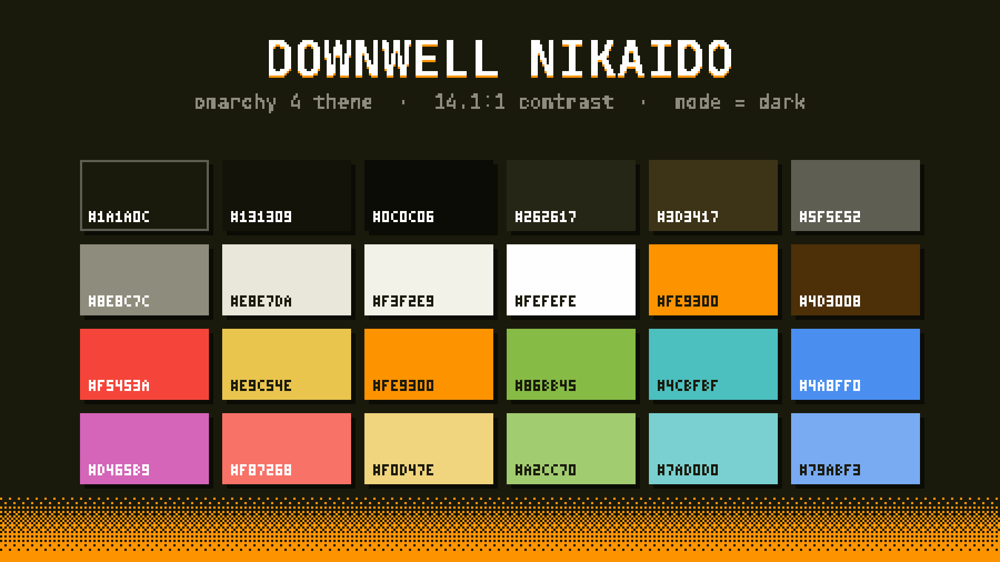

# Downwell Nikaido

A dark theme for [Omarchy](https://omarchy.org) 4 (Quattro) in
[Downwell](https://downwellgame.com)'s "Nikaido" palette: an olive-black field, white,
and one gunboot orange. An unofficial fan theme; Downwell is by Moppin, published by
Devolver Digital.

The game draws everything in three colors and nothing in between, so the theme does too
wherever it can: a solid orange window border with square corners and a hard, unblurred
drop shadow, opaque menus, and the chosen row framed in orange the way the game boxes
its selection. Its sister theme, [Downwell](https://github.com/LizinDev/omarchy-downwell-theme),
uses the game's original black/white/red palette.



## Install

```bash
omarchy theme install https://github.com/LizinDev/omarchy-downwell-nikaido-theme.git
```

## Palette

| Role | Hex | |
|---|---|---|
| background | `#1a1a0c` | the palette's olive-black: terminals, bar, popups, menus |
| foreground | `#e8e7da` | body text, 14.10:1 on background |
| bright_foreground | `#fefefe` | the palette's white: cursor, sprites |
| accent | `#fe9300` | the palette's orange: borders, selected rows, shortcuts |
| selection | `#3d3417` | text selection, btop meters |
| muted | `#5f5e52` | ANSI bright-black, dividers (the palette's `#58584d`, lifted a step) |

ANSI: `#f5453a` red · `#86bb45` green · `#e9c54e` yellow · `#4a8ff0` blue ·
`#d465b9` magenta · `#4cbfbf` cyan. Downwell has no other hues, so these were placed by
hue and kept a notch below the accent's saturation: the orange stays the loudest thing on
screen, as in the source image, where it is the only color that is not black or white.

The accent and `red` (wrong-password border, error text) sit 47.0 dE apart.

## What's here

| File | |
|---|---|
| `colors.toml` | the palette, which generates 17 app configs on its own |
| `hyprland.lua` | solid orange border, square corners, hard offset shadow |
| `shell.{menu,launcher,tooltip,lock}.toml` | opaque cards, orange selection frame, darker scrim |
| `icons.theme` | `Yaru-dark` (Yaru's own accent is orange) |
| `backgrounds/` | see below |
| `preview.png` | theme-switcher tile, a pixel-art palette specimen |
| `unlock.png` | Plymouth boot splash and SDDM logo |
| `chromium/extras/` | the Chromium companion's code (its art and the theme are built, see below) |
| `tools/` | the scripts that build the backgrounds, previews, shell overrides and the Chromium theme |

## Backgrounds

Only `4-dither.png` ships: the palette's three bands joined by ordered dither, generated
from `colors.toml`. The other six are built from Downwell's own art and stay local. Every
one uses exactly the theme's three colors:

| | |
|---|---|
| `1-clouds.png` | the cloud sea and heart balloon, the wallpaper the theme was drawn from, re-rendered in exactly the palette's three colors |
| `2-well.png` | a well shaft built from the game's tiles, enemies, gems and HUD |
| `3-title.png` | the DOWNWELL logo over the opening backdrop |
| `5-bros.png` | Super Welltaro Bros.: World 1-1 with gem ? blocks, a slime Goomba, a turtle Koopa and the stone well as the warp pipe |
| `6-terra.png` | Terrawell: a Terraria-style cross-section with the bucket well, the shopkeeper as the Guide, a torchlit tunnel, gem ore and a hotbar |
| `7-isaac.png` | The Welling of Isaac: a basement room with four doors, bubble tears at a fly swarm, a heart pedestal, a tinted gem rock and the minimap |

With your own copy of the game (Steam) and the Omarchywell project checked out at
`~/Projects/Downwell`, rebuild them from `colors.toml`:

```bash
tools/build-backgrounds.sh ~/Projects/Downwell/Wallpaper.png   # omit the argument to skip 1-clouds
```

The scripts read the game's sprites read-only through Omarchywell's
`tools/game_sprites.py`, swap black/white/red for this theme's background, white and
accent (the game's secondary blues and greens fold into the accent or the white), and
scale them 4× on an integer pixel grid.

## Chromium

`tools/chromium.py` builds a Chromium version of the theme into `chromium/`, from
`colors.toml` and the game's own sprites (so, like most backgrounds, it stays local):

- **`chromium/theme`**, a theme extension: the window in the game's black, the well's
  rubble rim along the top of the tab strip with bats and spiders hanging from it past
  the last tab, and a orange edge on the selected tab, the way the game underlines what
  is chosen. Chromium's own new tab page gets the title screen's backdrop.
- **`chromium/extras`**, its companion "Downwell Gunboots":
  - a new tab page drawn as the game's title screen, a still: the opening backdrop's
    ledges with the hero dropping in, the logo, a clock, a search box, and your most
    visited sites as a row of icons repainted in the palette's three colors, the chosen
    one framed by the game's cursor corners. Keys: `1`–`8` open a shortcut, arrows and
    `Enter` choose one, `/` or just typing searches.
  - a toolbar popup drawn as the pause menu: sound (off by default), page
    scrollbars and text selection in the orange, repainted icons, 24-hour clock.
  - scrollbars and selected text on every site in the orange, while those are on.

Everything is drawn in the game's font and sprites at a whole-number scale.

### Setup

Omarchy themes Chromium through a managed `BrowserThemeColor` policy, rewritten on
every theme switch, and while that policy exists Chromium refuses theme extensions. So
wiring this in takes one script, run once in a terminal:

```bash
python3 -I tools/chromium.py   # needs ~/Projects/Downwell and the Steam game
tools/chromium-setup           # asks for your password once
```

It installs a theme-set hook (`40-chromium-theme`) that copies the current theme's
`chromium/` build into `~/.local/share/omarchy-chromium-theme/{theme,extras}`, which it
adds to `--load-extension` in `~/.config/chromium-flags.conf`. It also installs
`/usr/local/bin/browser-theme-policy-clear`, root-owned, with a sudoers rule for exactly
that command and no arguments. The hook uses it to delete Omarchy's `color.json` policy
for themes that ship a Chromium build. On any other theme the companion goes to sleep,
Omarchy's color policy stays, and the browser looks as Omarchy made it.
`tools/chromium-setup remove` undoes all of it.

Chromium reads a theme only when it starts. Switching from another Omarchy theme, or
between Downwell and its sister theme, asks for a restart: the companion shows a `!`
badge, a banner on the new tab page and a notification (`chrome://restart`).

Two things a theme extension cannot reach: focus rings and the profile button keep
Chromium's own blue (Chromium only derives those from a seed color, which themes do
not set), and incognito windows ignore themes altogether.

## Caveats

**Installed from a git clone, this theme loses `hyprland.lua`.** Omarchy drops every
`.lua`, terminal config and `vscode.json` from a cloned theme. The palette and border
color survive (they live in `colors.toml`), but not the square corners and hard shadow.

**`shell.*.toml` overrides replace their whole section.** Their hex values are frozen
copies of `colors.toml`. After changing the palette, apply the theme, run
`python3 tools/shell-overrides.py`, then `omarchy theme refresh`.

## Working on it

Keep the repo outside `~/.config/omarchy/themes` and symlink it in. Omarchy treats a
directory with `.git` inside as a cloned theme and stages it with restrictions; it
never treats a symlink that way.

```bash
ln -s ~/Projects/omarchy-downwell-nikaido-theme ~/.config/omarchy/themes/downwell-nikaido
omarchy theme set downwell-nikaido
```
